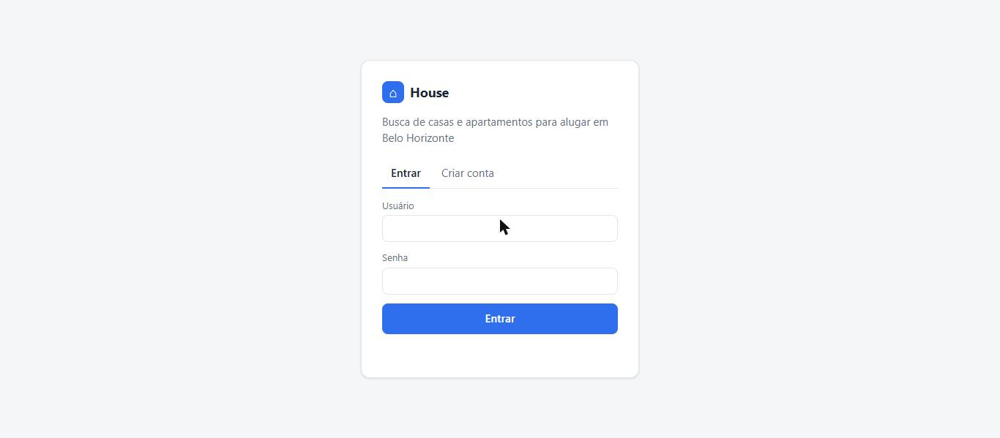
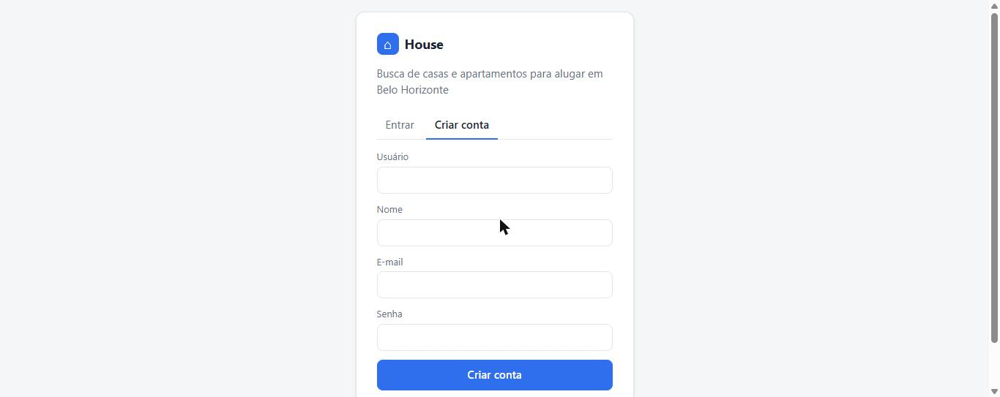
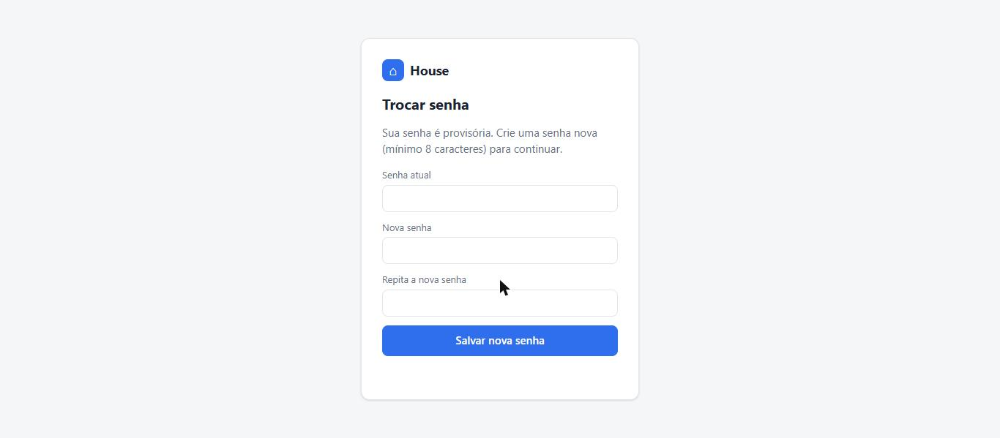
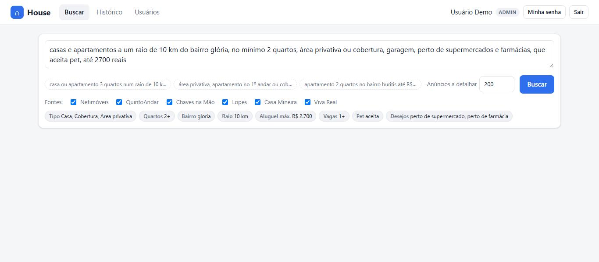
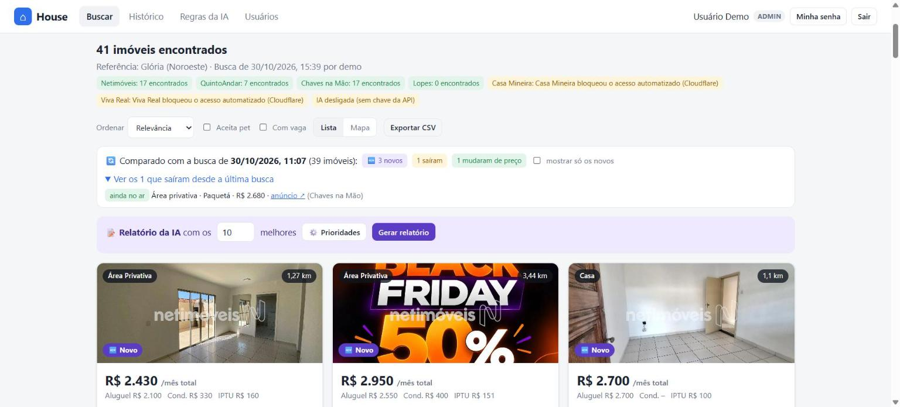
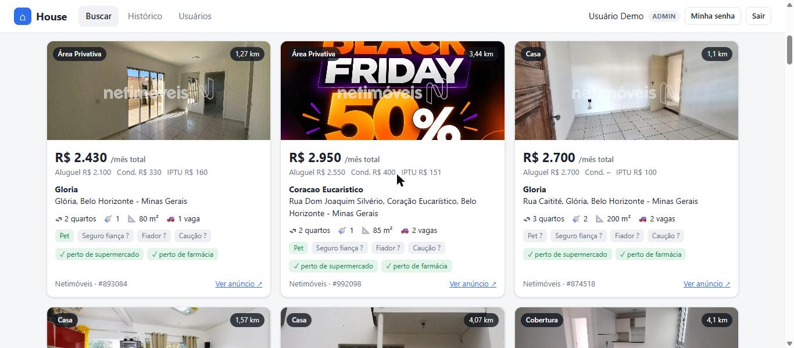
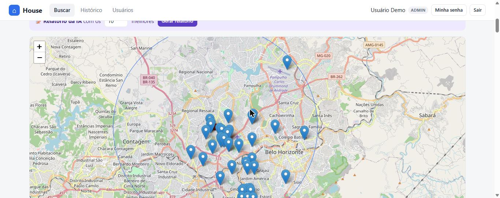
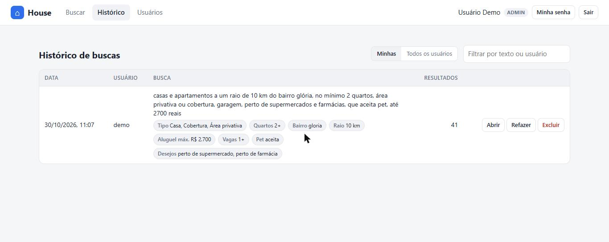
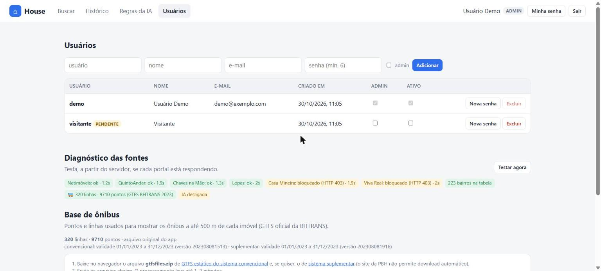
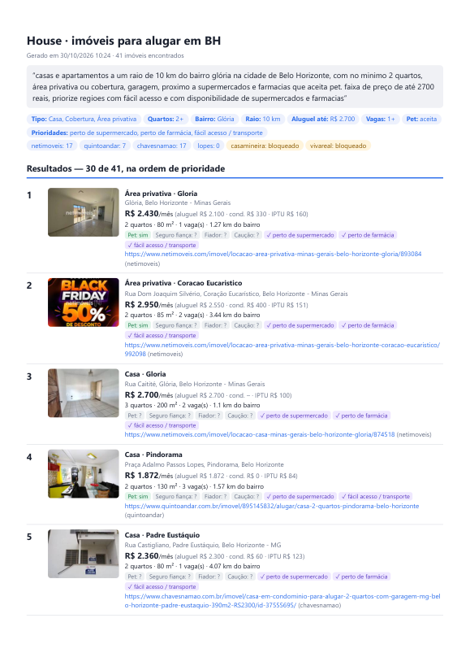

# Manual do usuário – House

O **House** busca casas e apartamentos para **alugar em Belo Horizonte** em vários portais ao mesmo
tempo. Você escreve o que procura do seu jeito ("casa 2 quartos perto do Glória até 2.500 com vaga")
e ele junta os anúncios, filtra, ordena pelo que mais combina com o pedido e, com a IA ligada, ainda
lê os anúncios e escreve um relatório com os melhores.

**Sumário**

1. [Acesso e conta](#1-acesso-e-conta)
2. [Fazendo uma busca](#2-fazendo-uma-busca)
3. [Entendendo os resultados](#3-entendendo-os-resultados)
4. [Relatório da IA](#4-relatório-da-ia)
5. [Histórico](#5-histórico)
6. [Administração (admins)](#6-administração-admins)
7. [Rodar no PC, publicar no site e gerar PDF](#7-rodar-no-pc-publicar-no-site-e-gerar-pdf)
8. [Dúvidas comuns](#8-dúvidas-comuns)

---

## 1. Acesso e conta

Abra o endereço do site (o do Render, `https://house-….onrender.com`). No plano gratuito o site
"dorme" após ~15 minutos sem uso: **o primeiro acesso pode levar 1–3 minutos** para carregar.

### Entrar



Digite usuário e senha e clique em **Entrar**.

### Criar conta



Na aba **Criar conta**, preencha usuário, nome, e-mail (opcional) e senha. A conta nasce
**pendente**: um administrador precisa aprová-la (ver [Administração](#6-administração-admins)) antes
do primeiro acesso. Até lá, o login mostra "Conta aguardando aprovação".

### Trocar senha



Senhas iniciais e senhas definidas por um admin são **provisórias**: no primeiro acesso o site só
mostra esta tela até você criar uma senha nova (mínimo 8 caracteres). Para trocar depois, use o botão
**Minha senha** no topo.

---

## 2. Fazendo uma busca



1. Escreva o pedido na caixa de texto, do jeito que falaria com um corretor.
2. Enquanto você digita, os **chips cinzas** mostram como o pedido foi entendido (tipo, quartos,
   bairro, raio, preço…). Se algo saiu errado, reescreva antes de buscar.
3. Escolha as **Fontes** (portais) — a escolha fica lembrada.
4. Clique em **Buscar** (ou Enter). A primeira busca de uma região leva **1–3 minutos**, porque o
   House abre cada anúncio; buscas repetidas usam cache e saem em segundos.

Os botões tracejados abaixo da caixa são **exemplos** prontos — clique para usar.

### O que o House entende

| Você escreve | Vira |
|---|---|
| casa, apartamento/apto, cobertura, área privativa, kitnet/studio | tipo do imóvel (nenhum citado = casa e apartamento) |
| "casa ou apartamento **com área privativa**", "apartamentos, **área privativa ou cobertura**" | o apartamento tem que ser desse tipo |
| "3 quartos" (= 3 ou mais), "2 a 3 quartos", "exatamente 2 quartos" | quartos |
| "bairro Glória", "perto do Castelo", "no Buritis" | bairro de referência (acentos e pequenos erros de digitação ok) |
| "raio de 10 km", "a 5 km do…" | distância máxima até o bairro |
| "até R$ 2.500", "2500 reais no máximo", "valor de 3 mil" | limite do **aluguel** |
| "**total** de até 2.700", "até 2.700 com condomínio" | limite de **aluguel + condomínio** |
| "vaga", "garagem", "2 vagas" (e "sem garagem") | vagas |
| "aceita pet", "aceita animais" | pet |
| "seguro fiança", "fiador", "caução", "título de capitalização" | garantias que você quer usar |
| "1º andar", "térreo" | andar (só para apartamento comum) |
| "perto de supermercado / farmácia / escola / hospital", "fácil acesso", "transporte", "quintal", "varanda", "mobiliado", "churrasqueira", "piscina", "elevador", "portaria 24h" | **prioridades**: não excluem nada, mas quem atende vem primeiro |

Com a **IA ligada** (ver [Dúvidas](#8-dúvidas-comuns)), o pedido é interpretado por um modelo de
linguagem: entende sinônimos, negações ("sem térreo") e qualquer outro desejo, e o chip roxo
**✨ entendido por IA** aparece.

**Anúncios a detalhar** (padrão 200): quantos anúncios o House abre para ler detalhes (coordenadas,
IPTU, pet…). Mais = mais completo e mais lento.

---

## 3. Entendendo os resultados



- **Referência**: o bairro usado como centro do raio e quem fez a busca.
- **Fontes** (verde = respondeu, amarelo = bloqueado ou com erro) e o estado da **IA**.
- **Ordenar**: relevância (padrão), distância, total mensal, aluguel ou área.
- **Aceita pet / Com vaga**: filtros rápidos só na tela.
- **Lista / Mapa** e **Exportar CSV** (abre no Excel).

**Relevância** = primeiro quem confirma o que você pediu (pet, vaga, garantias, prioridades), depois
o mais perto, depois o mais barato.

### Os cards



Cada card mostra:

- **Foto**, tipo e distância até o bairro de referência.
- **Total por mês** (aluguel + condomínio) e o detalhe: aluguel, condomínio e IPTU.
- Bairro e endereço; quartos, banheiros, área, vagas e andar (quando o anúncio diz).
- Etiquetas de condições: **verde** = o anúncio confirma, **riscada** = o anúncio nega,
  **"?"** = o anúncio não informa. Pedir "aceita pet" remove só quem diz que **não** aceita; quem não
  informa continua na lista (pergunte ao anunciante).
- **✓ prioridades** atendidas (ex.: "perto de farmácia"), conferidas nas características do anúncio.
- **Destaques** lidos pela IA (quando ligada).
- **Ver anúncio ↗** abre o anúncio original. **Também em:** o mesmo imóvel em outro portal.

### Mapa



Cada marcador é um imóvel (clique para ver preço e link). O ponto vermelho é o bairro de referência e
o círculo azul, o raio pedido.

---

## 4. Relatório da IA

Abaixo do cabeçalho dos resultados fica a faixa roxa **📝 Relatório da IA com os [10] melhores**
(visível na imagem de [resultados](#3-entendendo-os-resultados)). Escolha quantos imóveis (1 a 40,
padrão 10) e clique em **Gerar relatório** (até ~1 minuto). A IA recebe seu pedido e os 40 melhores
candidatos e devolve:

- **Resumo** do que a busca achou;
- **Ranking** com nota de 0 a 10, o motivo, pontos fortes, pontos de atenção e **perguntas para fazer
  ao anunciante** (sobre o que o anúncio não informa);
- **Comparativo** e **próximos passos** (qual visitar primeiro, o que confirmar).

No mapa, os imóveis do relatório aparecem como **marcadores roxos numerados** (1, 2, 3…), e o botão
**📍 Ver no mapa** de cada item leva até ele. Use **Recolher** para encolher o relatório e voltar a ver
o mapa e os cards logo abaixo.

A IA só usa os dados dos anúncios — confirme tudo com o anunciante. O relatório fica salvo junto da
busca e o botão **Imprimir / PDF** gera uma página limpa (no diálogo, escolha **Salvar como PDF**;
marque "Gráficos de plano de fundo" para sair com cores).

> Precisa da IA ligada. Sem chave de API, o botão avisa "IA desligada".

---

## 5. Histórico



Toda busca fica salva com quem pesquisou, quando, o texto, os filtros e os resultados.

- **Abrir**: mostra os resultados salvos (sem buscar de novo) e o relatório, se houver (📝).
- **Refazer**: roda a mesma busca de novo, com dados atuais.
- **Excluir**: apaga do histórico.
- Admins podem alternar **Minhas / Todos os usuários** e filtrar por texto ou usuário.

---

## 6. Administração (admins)



Na aba **Usuários**:

- **Aprovar cadastro**: marque **Ativo** na linha do usuário com o selo **pendente**.
- **Admin**: marque para dar acesso de administrador.
- **Nova senha**: define uma senha provisória (a pessoa troca no próximo acesso).
- **Excluir**: remove o usuário e o histórico dele.
- **Adicionar**: cria uma conta já ativa (senha provisória).

**Diagnóstico das fontes → Testar agora**: verifica, a partir do servidor, quais portais estão
respondendo, quantos bairros o House conhece e se a IA está ligada (e com qual modelo).

---

## 7. Rodar no PC, publicar no site e gerar PDF

Alguns portais (hoje o **Netimóveis**) bloqueiam o servidor na nuvem, mas respondem no seu PC. O
comando `publicar_busca.py` roda a busca no PC e **grava o resultado no Histórico do site** — e pode
gerar um **PDF**.

Pré-requisitos (uma vez): o projeto na pasta, a `.venv` criada (`.\run.ps1` cria) e o arquivo
`.env.local` com o `DATABASE_URL` do site (criado pelo `neon init`). Para IA, acrescente ao
`.env.local` uma linha `OPENAI_API_KEY=sk-...`.

**PowerShell** (na pasta do projeto):

```powershell
$env:PYTHONIOENCODING = "utf-8"; .\.venv\Scripts\python.exe publicar_busca.py "casa ou apartamento 2 quartos a 10 km do bairro glória, com garagem, aceita pet, até 2700 reais, perto de supermercado e farmácia" --relatorio 10 --pdf output\busca.pdf
```

**Git Bash**:

```bash
cd "/c/Users/<você>/Documents/Projects/House" && PYTHONIOENCODING=utf-8 .venv/Scripts/python.exe publicar_busca.py "o seu pedido" --relatorio 10 --pdf output/busca.pdf
```

| Opção | Para quê |
|---|---|
| `--pdf output/arquivo.pdf` | salva o PDF (e um `.html` ao lado) |
| `--pdf-top N` | quantos imóveis listar no PDF (padrão 30) |
| `--relatorio N` | inclui o relatório da IA com os N melhores (precisa de IA) |
| `--usuario manucfe` | publica no histórico de outro usuário (padrão: clovisguerim) |
| `--nao-publicar` | só gera o PDF, sem gravar no site |
| `--fontes netimoveis quintoandar` | limita os portais |
| `--sem-ia` | não usa IA mesmo com chave |

O comando mostra cada fonte, o total, se a IA está ligada e `PDF salvo em: … (fotos: 30 de 30)`.



---

## 8. Dúvidas comuns

**O pedido não foi entendido direito.** Confira os chips antes de buscar e reescreva usando as
palavras da [tabela](#o-que-o-house-entende). Com a IA ligada a interpretação fica bem mais flexível.

**Como ligar a IA?** No Render: serviço **house → Environment → Add Environment Variable**, nome
`OPENAI_API_KEY` (ou `ANTHROPIC_API_KEY`), valor = sua chave, **Save Changes**. Confira em
**Usuários → Diagnóstico**: "IA ligada (openai · …)". A conta da OpenAI precisa ter crédito.

**"Bairro não encontrado".** O House conhece ~220 bairros de BH. Verifique a grafia; se o bairro
existir e não for encontrado, peça para incluí-lo.

**Uma fonte aparece "bloqueado".** O portal recusa acessos do servidor. Netimóveis funciona rodando
no PC ([seção 7](#7-rodar-no-pc-publicar-no-site-e-gerar-pdf)); Casa Mineira e Viva Real bloqueiam
em qualquer lugar.

**"Limite de buscas por hora".** Usuários comuns têm até 20 buscas/hora (admins, sem limite) e uma
busca por vez.

**Os números de um anúncio parecem errados.** O House copia o que o portal publica (alguns anunciam
IPTU anual como mensal, por exemplo). Sempre confirme com o anunciante.
